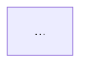

# Case study structure

The capstone (`SDN/`) and `experiment/README.md` follow one shape. Keep it identical so the
portfolio reads as a single document.

## Required section shape

```markdown
### <N>. <Domain> — <Specific system>

#### Use Case
One paragraph: who needed what, and why it mattered to the business.

#### Problem / Scenario & Solution
**Problem:** <constraint + failure mode, concretely>
**Solution:** <what you designed, with the trade-off you accepted>

#### Architecture Diagram


#### Technical Details
| Component | Choice | Why |
| --- | --- | --- |
| ... | ... | ... |

#### Outcome                 <!-- optional but preferred -->
- measurable result, score, or lesson
```

## Procedure

1. Confirm the domain section number — read the `###` headings in `experiment/README.md` and
   continue the sequence (`### 4. …`).
2. Fill **Use Case** and **Problem/Solution** from the user's notes. Every technology named must
   appear in a real config under `SDN/configure/`, `SDN/DevCode/`, or the description.
3. Build the diagram via the `mermaid-architecture` skill (subgraph per site/layer, `classDef`
   per role, numbered edge labels). Cap at ~40 nodes.
4. Add the components table — 3 columns as above, 4–8 rows. "Why" must be a constraint, not a
   feature list ("kept L2 adjacency for DHCP broadcast", not "supports DHCP").
5. If the claim is verifiable in this repo, link it relatively — for example a link to the
   `SDN/configure/` or `SDN/DevCode/` folder. Otherwise link externally.
6. Re-read the `AGENTS.md` "Never invent" rule; leave `<!-- TODO: metric -->` rather than guessing.
7. Update `SDN/README.md` only if the file layout changed.

## Checklist before saving

- [ ] Section numbering continues the existing sequence
- [ ] Problem has a *constraint* and a *failure mode*
- [ ] Mermaid renders (validated, not eyeballed)
- [ ] Table has a "Why" column with trade-offs
- [ ] At least one link back to evidence in this repo
- [ ] No employer-internal identifiers
