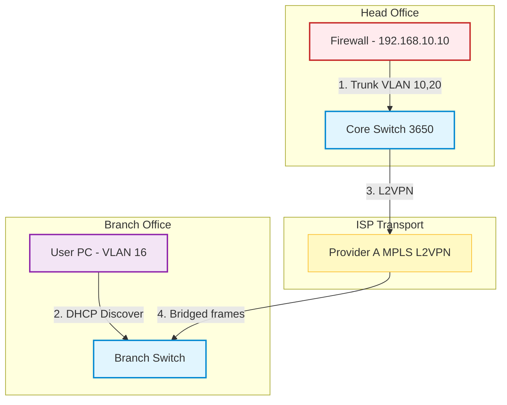
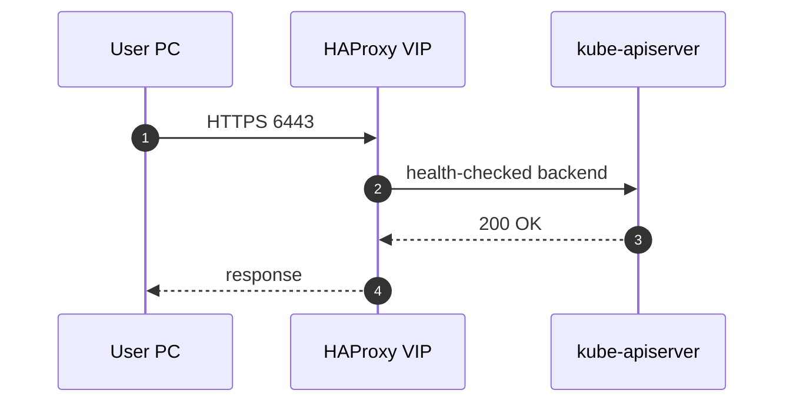

# Mermaid architecture diagrams

House style for every diagram in this repo. A diagram that does not render is worse than no diagram.

## Non-negotiables

1. `graph TD` for topology, `sequenceDiagram` for protocol/flow, `flowchart LR` only for pipelines.
2. Every node role gets a `classDef`; apply with `:::name`.
3. Every edge that carries a protocol, port, VLAN, or step number gets a label.
4. Node labels with `/ : ( ) -` are quoted: `FW["FortiGate - 192.168.10.10"]`.
5. Subgraph per physical site or logical layer, with a quoted display title.
6. ≤ 40 nodes. If you need more, split into "logical" and "flow" diagrams.

## Palette (copy this block)

```mermaid
graph TD
    classDef edge fill:#e1f5fe,stroke:#0288d1,stroke-width:2px
    classDef firewall fill:#ffebee,stroke:#c62828,stroke-width:2px
    classDef service fill:#f3e5f5,stroke:#8e24aa,stroke-width:2px
    classDef wan fill:#fff9c4,stroke:#fbc02d,stroke-width:1px
    classDef compute fill:#e8f5e9,stroke:#2e7d32,stroke-width:1px
    classDef branch fill:#efebe9,stroke:#4e342e,stroke-width:1px
```

| Class | Meaning |
| --- | --- |
| `edge` | router/switch/core |
| `firewall` | firewall, proxy, security boundary |
| `service` | VM, pod, app, control-plane component |
| `wan` | ISP / MPLS / transport |
| `compute` | hypervisor host, cluster, storage |
| `branch` | user endpoint or remote site |

## Skeleton (topology)



## Skeleton (sequence)



## Procedure

1. Decide the diagram *question* — "how does traffic reach the cluster?" Not "draw everything".
2. Draft in a scratch file `diagram.mmd` (Mermaid only, no fences).
3. Validate:
   - Structural check (always available, no Node needed):
     ```bash
     python3 .agents/skills/repo-hygiene/scripts/repo-audit.py     # flags unbalanced subgraph/end
     ```
   - Visual check: paste into <https://mermaid.live> and confirm there is no red error panel.
   - If Node is installed, a CLI render also works:
     ```bash
     npx -y @mermaid-js/mermaid-cli -i diagram.mmd -o /tmp/diagram.svg
     ```
4. Fix the usual failures:
   | Error | Fix |
   | --- | --- |
   | `Parse error ... got 'PS'` | quote the label: `N["a:b"]` |
   | node swallowed by `--` | replace `-` with `–` or quote the label |
   | subgraph title unquoted with spaces | `subgraph ID["Title here"]` |
   | `classDef` not applied | ensure `:::name` sits after the closing bracket |
5. Insert the validated block into the document with the ```mermaid fence.
6. Delete the scratch `.mmd` file.

## Anti-patterns

- `flowchart` with bidirectional arrows everywhere — pick a direction.
- Emoji as node icon (renders differently per renderer).
- A diagram that only repeats the prose. It must show *connection* or *sequence*.
- PNG screenshots of Mermaid output in `src/` — keep the source.
