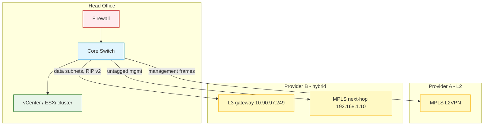
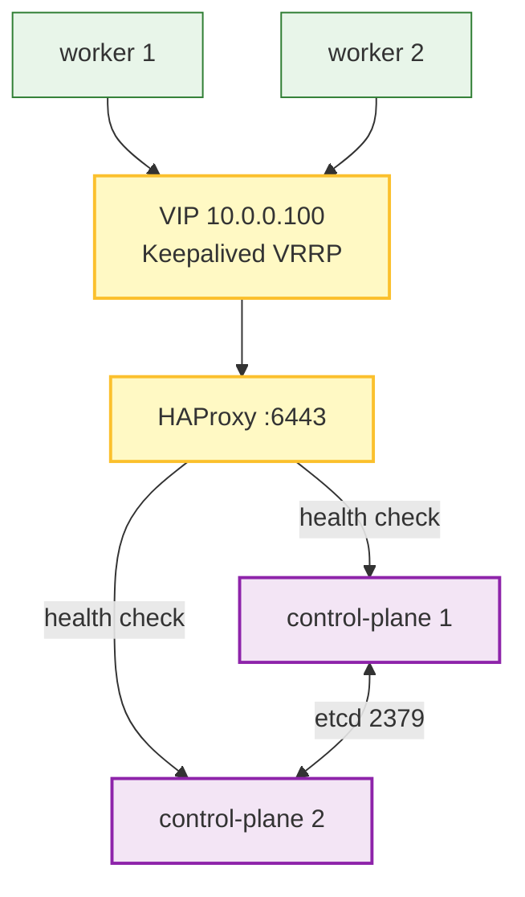
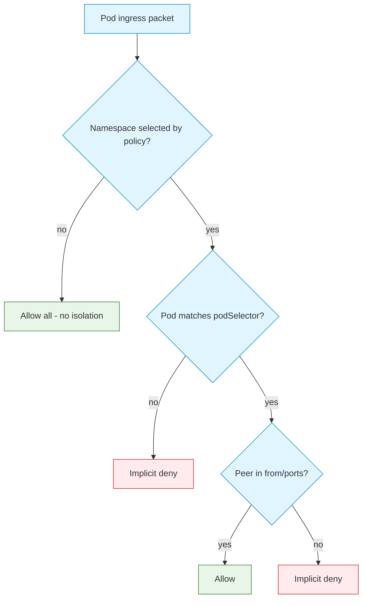
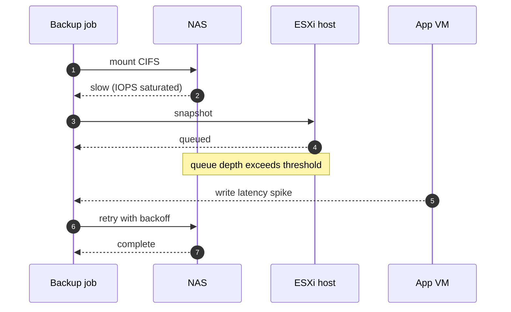

# Diagram recipes used in this repo

Each recipe is a validated starting point. Replace content, keep structure.

## 1. Dual-WAN branch to head office (used in `experiment/` §1.1)



## 2. Kubernetes HA control plane



## 3. NetworkPolicy decision flow



## 4. Sequence — storage outage during backup window



## Rendering check helper

Structural check without Node:

```bash
python3 .agents/skills/repo-hygiene/scripts/repo-audit.py
```

Visual check: paste the block into <https://mermaid.live>. With Node installed, a full render is:

```bash
# .mmd file → svg, prints nothing on success
npx -y @mermaid-js/mermaid-cli -i diagram.mmd -o /tmp/out.svg >/dev/null && echo "OK"
```
